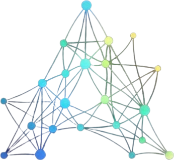

<p align="center">
  
</p>

<h1 align="center">Arcana</h1>

<p align="center">
  Search, explore and tell stories with large image and audio collections —<br>
  by what they look and sound like, not by what they are called.
</p>

---

## What it is

A photo library is usually searchable only by the things written down about it:
filenames, folders, dates, whatever you were disciplined enough to tag. The
pictures themselves are opaque. Ten thousand images means ten thousand things
you can only find by remembering where you put them.

Arcana makes the contents searchable. It runs every file through a
**vision–language model** — CLIP for images, CLAP for audio — which turns each
one into a few hundred numbers describing what is *in* it. Those numbers live in
a shared space with the same model's reading of English, so a sentence and a
photograph can be compared directly.

Two useful things follow.

**You can search by description.** Type *"a quiet street at dusk"* and get the
pictures that look like that, from a collection nobody ever tagged. Type
*"distant thunder"* at a folder of field recordings and get the right sounds.
Nothing was labelled; the model recognises the content.

**The collection gets a shape.** Every file has a position, so the whole library
can be laid out as a map where similar things sit together. Related pictures
form visible clusters, each named automatically, and you navigate by looking
rather than by scrolling a list of filenames.

On top of that sit two tools that use the same representation: a **moodboard**
that finds images by colour palette or texture and transfers the colours of one
onto another, and a **story mode** that assembles a visual narrative from a
sequence of scene descriptions.

## What you already decided

If you cull in **ON1 Photo RAW**, Arcana reads the sidecars it leaves beside
your photographs: star ratings, colour tags, and the date each frame was shot.
Those become filters — *four stars and up*, *the red pile*, *that week in June* —
which narrow the map as you set them and constrain what a prompt can return.
Adobe-format `.xmp` sidecars are read too, and a file with no sidecar at all
still contributes its capture date from its own EXIF.

Nothing is re-guessed and nothing is written back: this metadata records
decisions you already made, and the machine should defer to them. **What's
marked** shows the whole collection as stars against colour tags, and every cell
of it is a filter you can click.

## Adding to a dataset

An archive grows every week. `arcana dataset extend`, or **Add new** beside a dataset,
encodes only the files that were not there last time — the rest is reused, so it
costs the price of the new pictures rather than of the whole collection. The map
is then laid out again over everything, which does mean clusters can move and be
renamed.

It is meant for people with more images than they can remember — photographers,
researchers, artists, anyone with an archive.

## Learning from a set

A search for *ice* or *water reflections* gathers a few hundred pictures in
seconds, and those pictures can teach Alchemy a material.

**Sets.** In Search, **Save to a set** puts the selected results, or all of them,
into a named set. A set keeps the pictures where they are and records the
searches that filled it, so it can grow over several searches. Collections stay
your moodboards, and sets sit on their own shelf in the header's picker. **Copy
the files out** exports a set to `output/search/<name>` for other tools.

**IP labels.** An IP label is a named position in the space Stable Diffusion's
IP-Adapter reads, measured as the centre of a set's pictures, of the best
matches for some words, or of one picture. A dataset indexed with CLIP
ViT-H/14 already holds each picture's IP-Adapter vector, so a label of a few
hundred pictures takes about a second. In Alchemy, the IP-Adapter, ControlNet
and texture LoRA methods draw from a label in place of a material picture. They
mix two labels, move a material picture toward a label, push a label further
from the average picture, or start from one of its members. A film lane on
`mix` walks from one label to the other, and a label searches a ViT-H dataset
for more pictures like it.

**Drawing on a set.** A set's IP label carries its style everywhere a material
goes. "Picture in a material" redraws a whole picture in it, the Generate tab
draws new material from it, and "material on a thing" puts it on one named
thing. That last one uses FLUX.2 klein, shown a swatch drawn from the set's own
pictures. Training a LoRA on a set (`lora train`) still works from the command
line, but its menu entries are hidden. In the tests so far a learned look did
not beat the label, and LORA_ROADMAP.md says what would bring it back.

## Demo — search mode


## Demo — story mode


## Install

Three ways, depending on who you are — see **[INSTALLATION.md](INSTALLATION.md)**
for the details.

| | for | command |
|---|---|---|
| **Installer** | using Arcana on Windows | run `Arcana-Setup-<version>.exe` |
| **uv** | developing on it | `uv sync && uv run python -m arcana.arcana` |
| **pip** | adding it to an environment you already have | `pip install .` then `arcana` |

The installer needs nothing else. The other two need Python 3.10+.

There is also `Arcana-Setup-<version>-GPU.exe`, the same application built with
CUDA PyTorch. It is a much larger download and only worth it if you have an
NVIDIA card — search never needs one. It matters most for indexing with the
largest encoder and for Inject Poetry, which is about 29× faster on a GPU. Both
installers share an identity, so installing one over the other swaps the build
in place. If you take the CPU one and Arcana finds a card it cannot use, it says
so rather than leaving you to wonder why things are slow.

## First run

Arcana opens on the **Datasets** tab, which walks you through five steps:

1. **Point at a folder** — everything inside, including subfolders
2. **Check what it found** — media type and name are detected from the folder
3. **Choose the quality** — a stronger encoder understands prompts better but
   takes longer to index
4. **How to name the groups** — how many clusters, and where their names come
   from: Arcana's word list, or your own subfolder names
5. **Extras, then go** — colour palette, style and thumbnails, then Start
   indexing

The encoder downloads itself on first use (605 MB for the fast one). Indexing
10,000 photographs takes about seven minutes on a CPU, three with a GPU.

Once a dataset is built it appears in the **Dataset** menu at the top of every
tab, and the other three tabs come alive.

## Your files stay put

Arcana reads your media where it lives. Nothing is copied, moved or uploaded —
it builds an index beside your collection and leaves the originals alone.
Everything runs on your own machine, including the models.

What Arcana creates goes in one place:

| | |
|---|---|
| Windows | `%LOCALAPPDATA%\Arcana` |
| macOS | `~/Library/Application Support/Arcana` |
| Linux | `~/.local/share/arcana` |
| anywhere | set `ARCANA_DATA_DIR` |

That folder holds the indexes, the downloaded models and anything you save. It
survives uninstalling, and pointing two machines at the same one lets them share
datasets.

**If you connect an agent** (below), the agent's model may not be on your
machine. Search, palettes and transfers still run here, and your files still
stay put. What reaches the model is the theme you ask for, the agent's queries,
and the text of the results: cluster names, colours, file names. Thumbnails are
**not** sent unless you allow it, by putting `{"pixels": true}` in `agent.json`
in the folder above. No tool can change that setting, and every result the agent
gets says which way it is set. Point a local model's client at the server
instead and nothing leaves at all.

## Working with an agent

The **Agent** tab runs an agent inside Arcana: Claude Code, or another agent
command line found on your machine, in a terminal in the app. It works in the
Arcana workspace, a folder beside Arcana's outputs, where it finds Arcana's
tools and the moodboard, board-design and harmonize skills already set up.
Close the tab and it keeps running; open it again and its session is still
there. Add other agents in `agents.json` in Arcana's data folder.

Arcana also offers your archive to an AI agent outside the app over MCP, as one tool that takes the
same op lines you type after `arcana`. An agent can survey a dataset, search it
for several ideas at once, build a moodboard with sections, notes and a
palette, recolour or restyle pictures, generate the odd missing picture, and
lay the board out as an HTML page. It acts as `agent`, so it changes only
boards an agent made and works on a copy of yours. Every batch it sends is one
step that `undo` takes back. While the app is open, its calls run in the app,
and its boards appear in the Moodboard tab within two seconds.

Claude Code picks the server up from `.mcp.json` in this repository. The
installed app serves agents too: the Datasets tab's *Working with an agent*
panel gives the command that connects it. For the skills, install the plugin:

```
/plugin marketplace add <path to this repository>
/plugin install arcana@arcana
```

It brings three skills: `moodboard` (the workflow), `board-design` (judging a
board) and `harmonize` (when and how to recolour). The design is in
[OPS_PLAN.md](OPS_PLAN.md).

## Command line

One command, `arcana`. Without arguments it starts the app. With an op line it
runs the op, the same one the app and an agent use.

```bash
arcana                                              # the app
arcana op list                                      # every op
arcana search text --help                           # any op's help
arcana dataset create holiday --folder ./photos     # index a folder
arcana dataset extend holiday                       # last weekend's shoot
arcana dataset finish holiday --k 12                # re-cluster or re-lay-out, no re-encoding
arcana dataset marks holiday                        # re-read ON1 stars and colour tags
arcana dataset relocate holiday --root D:/photos    # after moving your files
arcana dataset migrate                              # older datasets to the portable format
arcana search text holiday --phrase "rain on a dark street"
arcana board render monsoon                         # a board as one HTML page
arcana colour lut DSC0042.jpg --reference DSC0177.jpg --out grade.cube
arcana undo                                         # take back your last step
arcana-mcp                                          # the agent's server, over MCP on stdio
```

`arcana --batch lines.txt` runs a file of op lines as one step. `--json`
before the op prints the result as JSON, and `--sheets` writes contact sheets
for searches to `output/sheets`. `arcana completion powershell` (or bash, zsh)
prints a completion script. While the app is open the command runs in it,
sharing its models.

The older commands (`arcana-build-latent`, `arcana-extend`, `arcana-finish`,
`arcana-marks`, `arcana-relocate`, `arcana-migrate`, `arcana-lut`) still work
for this release. Each prints the op line it now stands for.

## Requires

Python 3.10 or newer. A GPU is optional: search never needs one, and indexing
works without one — it is simply slower with the larger encoders.

## Licence

Not yet declared. `pyproject.toml` sets no licence and the repository has no
LICENSE file, which means default copyright applies and others have no explicit
right to use or redistribute this.

[LICENSING.md](LICENSING.md) records the plan — AGPL-3.0-or-later and
third-party notices. The item that used to block distributing builds is
resolved: the installers no longer bundle source from a repository that has no
licence, because `arcana/modflows_net.py` replaced it with our own
implementation of the same colour-transfer inference path.
